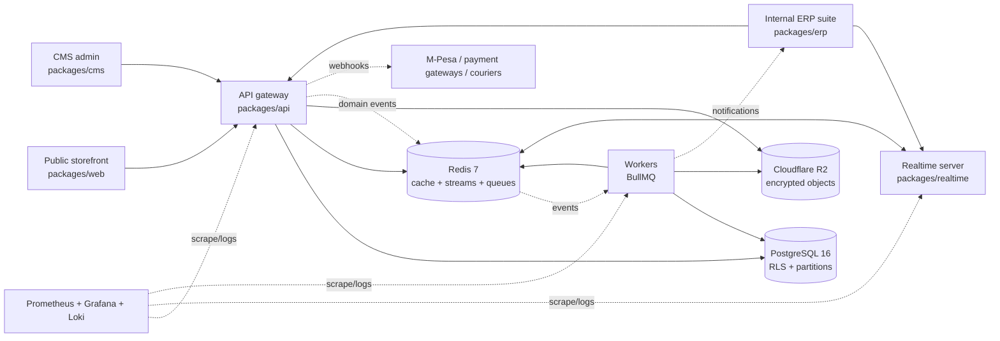

# Comet Healthcare Enterprise Platform — Architecture Overview

**Version:** 1.0 (Phase 1)  
**Date:** 2026-11-22  
**Status:** Draft for review  
**Owner:** Principal Architect

---

## 1. Purpose

This document defines the target architecture for extending the existing Comet Healthcare platform from a public storefront plus CMS into an enterprise-grade business system for a Kenyan GMP pharmaceutical manufacturer and CDMO.

The brief supplied the placeholder name “Crown Appliances”. The approved product identity for this repository is **Comet Healthcare**. All naming, compliance scope, and domain language in this architecture therefore follow Comet Healthcare’s pharmaceutical/CDMO business.

> This is a living document. Each phase updates it before implementation begins.

---

## 2. Baseline (what actually exists today)

| Area | Current state | Target state |
|---|---|---|
| Frontend | React 19, Vite 8, Tailwind 4, React Router 7 in a single `src/` folder | npm workspaces: `web` (storefront), `cms` (content admin), `erp` (internal suite) |
| API | Express 5 in `server/`, Zod validation, JWT + bcryptjs, Nodemailer | `api` package with modular routers, service layer, tenant context, OpenAPI |
| Database | SQLite via Prisma 6 (`file:./dev.db`) | PostgreSQL 16 with RLS, partitioning, PgBouncer, raw SQL migrations |
| Content | CMS stored in `Setting` table, Content Studio UI | Dedicated `cms` workspace using the same API and storage abstractions |
| Auth | Role enum `PATIENT` / `PROVIDER` / `ADMIN`, JWT in `localStorage` | Users, groups, departments, branches, RBAC + ABAC, sessions, TOTP, OIDC |
| Messaging | None; Nodemailer dev-mail only | Self-contained internal inbox platform, real-time, attachments, notifications |
| Jobs / events | None | Redis Streams (domain events) + BullMQ (jobs) |
| Observability | Console logs | Structured JSON logs, correlation IDs, Prometheus/Grafana, Loki, error tracking |
| Hosting | Node process on a port; local preview | Single VPS with Docker Compose; Caddy TLS; optional Hostinger static CDN |

The baseline does **not** yet contain PostgreSQL, Redis, a real-time server, workers, or a monorepo. Phase 2 establishes those foundations alongside the first migrations.

---

## 3. Guiding principles

1. **Multi-tenant ready** — every business record carries `company_id`; every query is tenant-scoped by PostgreSQL RLS.
2. **Multi-branch** — Nairobi HQ, Machakos plant, warehouses, workshops, and showrooms are first-class branches; data can be scoped by branch.
3. **Event-driven** — state changes emit domain events with correlation IDs; modules react without direct coupling.
4. **API-first** — every capability is exposed through documented REST endpoints with OpenAPI and versioned contracts.
5. **Security by default** — least privilege, envelope encryption, TLS, immutable audit trail, zero trust between modules.
6. **Observable** — structured logs, metrics, traces, and alerting from the first deployment.
7. **Compliant** — Kenya Data Protection Act 2019, KRA VAT 16% readiness, eTIMS-ready payloads, PCI-DSS scope minimisation.
8. **Internal communication independent of external email** — staff messaging never leaves the platform.

---

## 4. Architectural style decision

**Modular monolith first**, with strict module boundaries and an internal event bus. See `docs/decisions/ADR-0001-modular-monolith.md`.

Rationale:

- Launch target is 500 concurrent users on one VPS.
- A distributed microservice topology would add network failure modes, deployment complexity, and observability cost before they are justified.
- Module boundaries are enforced in code (`packages/shared` contracts, service layers, no cross-module ORM joins).
- Each module can be extracted into a service later by replacing in-process calls with API/event calls.

---

## 5. System context

---

## 6. High-level package map

| Package | Responsibility | By phase |
|---|---|---|
| `packages/shared` | Zod schemas, permissions, event contracts, constants, i18n strings | 2 |
| `packages/api` | Express gateway, auth context, REST routers, module service layer | 2 |
| `packages/realtime` | Socket.IO server with Redis adapter, presence, typing, receipts | 4 |
| `packages/workers` | BullMQ workers, scheduled jobs, document generation, scanning | 5 |
| `packages/web` | Public storefront (migrated from current `src/`) | 2 |
| `packages/cms` | Content Studio (migrated from current portal CMS) | 2 |
| `packages/erp` | Internal business suite UI | 3 |

Detailed boundaries are in `01-bounded-contexts.md` and `02-module-map.md`.

---

## 7. Cross-cutting concerns

| Concern | Approach |
|---|---|
| Tenant isolation | `company_id` on every business table; RLS policies use transaction-local `app.company_id` |
| Branch scoping | `branch_id` on addressable records; ABAC policies compare session branch to record branch |
| Audit | Append-only `audit_log` with SHA-256 hash chaining; written from domain events |
| Encryption | TLS 1.2+ everywhere; AES-256-GCM envelope encryption for restricted columns and object payloads |
| Notifications | In-app first; Web Push/FCM, SMS, WhatsApp adapters behind one interface |
| Search | PostgreSQL full-text search first; permission-aware filtering at query level |
| i18n | English and Kiswahili, locale-aware KES formatting and dates |
| Feature flags | Per company, branch, and role; evaluated server-side |
| Health/readiness | `/health/live`, `/health/ready`, read-only mode when DB is degraded |

---

## 8. Phasing

Phase 1 is documentation only. Phase 2 creates the workspace skeleton, ERD, and first migrations (Identity, Organisation, Messaging). Each later phase follows the same gate: tests, changelog, OpenAPI update, documentation update, then stop for review.

See the phase table in the Phase 1 approval response and `CHANGELOG.md`.
