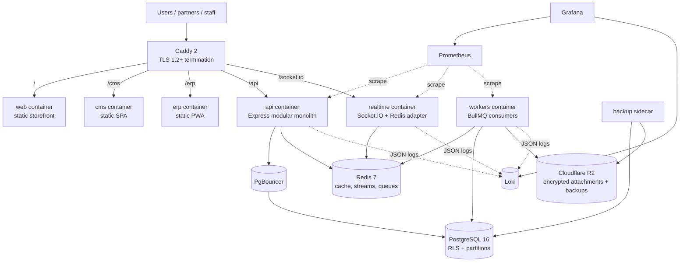

# Deployment Topology

Comet Healthcare Enterprise Platform — Phase 1  
Version 1.0 · 2026-11-22 · Status: Draft for review

---

## 1. Target environment

The approved launch topology is a **single VPS running Docker Compose**, with Caddy terminating TLS at the edge. Hostinger shared hosting is not used for backend services; it may only host static assets/CDN content if required.



---

## 2. Container responsibilities

| Container | Image basis | Responsibility | Restart policy |
|---|---|---|---|
| `caddy` | `caddy:2-alpine` | HTTPS, HTTP/2, compression, basic WAF headers, static SPA fallback | `unless-stopped` |
| `web` | nginx-served static build | Public storefront and booking flow | `unless-stopped` |
| `cms` | nginx-served static build | Content Studio SPA | `unless-stopped` |
| `erp` | nginx-served static build | Internal business suite + offline PWA assets | `unless-stopped` |
| `api` | Node 22 Alpine | Express gateway, REST modules, auth context, outbox publisher | `unless-stopped` |
| `realtime` | Node 22 Alpine | Socket.IO, presence, typing, receipts, polling fallback hints | `unless-stopped` |
| `workers` | Node 22 Alpine | BullMQ consumers, documents, scans, retention, reports | `unless-stopped` |
| `postgres` | `postgres:16-alpine` | Primary database with RLS and partitioned tables | `unless-stopped` |
| `pgbouncer` | `edoburu/pgbouncer` | Transaction pooling, protected DB connections | `unless-stopped` |
| `redis` | `redis:7-alpine` | Cache, rate limits, Streams, BullMQ, Socket.IO adapter | `unless-stopped` |
| `prometheus` | `prom/prometheus` | Metrics scrape and alert rules | `unless-stopped` |
| `grafana` | `grafana/grafana` | Dashboards and alert routing | `unless-stopped` |
| `loki` | `grafana/loki` | Structured log retention | `unless-stopped` |
| `promtail` | `grafana/promtail` | Container log shipping | `unless-stopped` |
| `backup` | restic-based custom job | Hourly incremental + daily full backups, restore verification | scheduled |

> Monitoring containers are launch-sized. If the VPS is memory constrained, use a hosted Loki/Grafana equivalent before removing application observability.

---

## 3. Suggested VPS sizing

| Tier | vCPU | RAM | Disk | Use case | Notes |
|---|---:|---:|---:|---|---|
| Launch (recommended) | 4 | 8–16 GB | 160–240 GB NVMe | 500 concurrent users, single company, multiple branches | 16 GB RAM gives headroom for Postgres + Redis + Node + monitoring |
| Minimum smoke | 2 | 4 GB | 80 GB | Development/staging only | Not recommended for production launch |
| Scale-up threshold | 8 | 16–32 GB | 320 GB+ | >800 concurrent users or heavy reporting | Split workers/realtime or move monitoring off-box first |

Sizing must be validated by the k6 load tests planned in Phase 7 testing gates and documented before go-live.

---

## 4. Networks and volumes

```text
Docker networks:
  edge      caddy <-> web/cms/erp/api/realtime
  app       api/realtime/workers <-> pgbouncer/redis
  data      pgbouncer <-> postgres; backup <-> postgres
  observability api/realtime/workers -> prometheus/loki

Named volumes:
  pg_data            PostgreSQL data directory
  redis_data         Redis persistence (AOF)
  r2_cache           temporary signed-download/cache, never source of truth
  grafana_data       dashboards and alert state
  prometheus_data    short-term metrics retention
  loki_data          short-term log retention
```

No application source of truth is stored inside a container writable layer.

---

## 5. Request routing

| Path | Destination |
|---|---|
| `/` | `web` |
| `/cms/*` | `cms` |
| `/erp/*` | `erp` |
| `/api/*` | `api` |
| `/socket.io/*` | `realtime` |
| `/health/live` | `api` (no dependencies) |
| `/health/ready` | `api` (checks Postgres, Redis, object storage) |
| `/metrics` | internal network only; scraped by Prometheus |

Caddy adds `X-Request-ID` if absent. The API uses it as `correlationId` across logs, events, jobs, and error reports.

---

## 6. Data residency and external services

| Service | Data held | Location | Review required |
|---|---|---|---|
| VPS provider | Application logs, DB backups in transit to R2 | Provider region selected at purchase | Confirm region, DPA, and support SLA |
| Cloudflare R2 | Encrypted attachments, generated documents, off-site backups | Configurable/region behaviour must be confirmed | ODPC cross-border transfer assessment; see `07-compliance-kenya.md` |
| Africa’s Talking | SMS/urgent alert phone numbers and message text | Provider-controlled | ODPC processor agreement; consent and purpose limitation |
| Web Push / FCM | Device tokens and notification payloads | Provider-controlled | Consent, data minimisation, delete-on-logout |
| Payment gateways / M-Pesa | Payment references and callback metadata | Provider-controlled | PCI scope note; never store PAN/CVV |
| Error tracking (self-hosted GlitchTip preferred) | Stack traces and request context | VPS or chosen hosted region | Scrub restricted fields before capture |

---

## 7. Backup and recovery

- PostgreSQL: daily full backup, hourly incremental/WAL archival, PITR enabled.
- Off-site copy: encrypted restic repository in R2 with a separate key from application envelope keys.
- Application metadata: Redis is reconstructible; only persistent queues need AOF.
- RTO: **4 hours**. RPO: **1 hour**.
- Quarterly restore drills; results recorded in `docs/runbooks/` from Phase 17.
- Backup restore is tested against a clean Compose stack, not only checksum-verified.

---

## 8. Deployment strategy

1. GitHub Actions runs lint, tests, contract tests, and container build.
2. Staging deploy on merge to `develop`; production deploy on tagged release.
3. Compose pulls new images, starts new containers, waits for `/health/ready`, then switches Caddy upstream/weights.
4. Database migrations run as a one-shot `migrate` container with a recorded version and rollback script.
5. Failed health checks stop the rollout and keep the previous image running.

Full blue-green is not required at launch; rolling replacement with health gates is adequate. Revisit if zero-downtime schema changes become frequent.

---

## 9. Failures and graceful degradation

| Failure | Behaviour |
|---|---|
| Redis unavailable | API serves cached/DB reads where safe; realtime falls back to polling; writes queue locally only if outbox permits |
| Postgres degraded | Read-only mode banner in ERP; messaging writes paused; health readiness fails |
| Object storage unavailable | Uploads paused; existing signed URLs remain valid until expiry; clear user message |
| Worker backlog | Notification digests delayed; critical in-app notification still written directly |
| Caddy down | Site unavailable; alert via out-of-band channel defined in ops handbook |

---

## 10. Infrastructure as code

Phase 1 selects **cloud-init + Ansible-style provisioning scripts** for the single VPS because Terraform adds little value for one host. If the platform later moves to k3s or multi-region, introduce Terraform/Pulumi then with a separate ADR.
