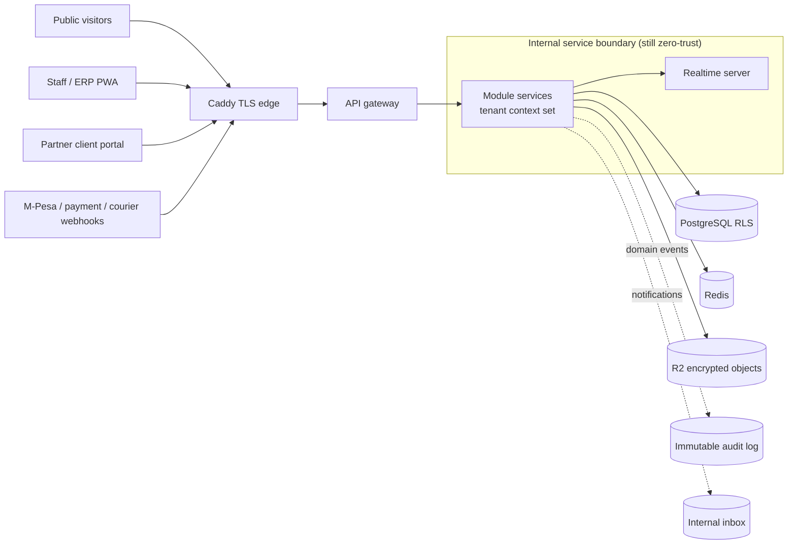

# Security Architecture

Comet Healthcare Enterprise Platform — Phase 1  
Version 1.0 · 2026-11-22 · Status: Draft for review

---

## 1. Security objectives

1. Enforce tenant and branch isolation even when application code has a bug.
2. Keep staff communication inside the platform; external email is only for external recipients.
3. Make every privileged action attributable and tamper-evident.
4. Minimise PCI-DSS scope by never storing cardholder data.
5. Meet OWASP ASVS Level 2 controls for the ERP, CMS, and public API.
6. Support Kenya Data Protection Act duties, including rights requests and breach response.

---

## 2. Trust boundaries



Every hop is authenticated. Internal containers use short-lived service tokens or mTLS if the service mesh is introduced later; “inside the Docker network” is not treated as trusted.

---

## 3. Authentication and session security

| Control | Implementation |
|---|---|
| Password policy | Minimum 12 chars, breach-list check via HIBP k-anonymity API, rate-limited attempts, no reuse of last 5 |
| MFA | TOTP + recovery codes in Phase 3; WebAuthn interface reserved but deferred |
| SSO | OIDC first; SAML/LDAP behind provider interfaces for later phases |
| Sessions | Device list, IP/UA binding hints, concurrent-session limit, force logout, idle + absolute expiry |
| Tokens | Short-lived access JWT, rotating refresh token in `HttpOnly; Secure; SameSite=Strict` cookie for ERP; API keys scoped separately |
| API clients | OAuth2 client credentials for public API, per-key scopes and rate limits |
| Password reset | Single-use token, short TTL, external email only to verified external addresses; never used for internal delivery |

JWTs carry `sub`, `companyId`, `branchIds`, `roles`, `sessionId`, `scope`, `exp`, `jti`, and `correlationId`. Authorization decisions are rechecked server-side; client claims are never sufficient.

---

## 4. Authorization: RBAC + ABAC

- **RBAC** grants capability by role: `finance.view.invoice`, `messaging.assign.thread`, `inventory.approve.transfer`.
- **ABAC** narrows by `companyId`, `branchId`, `departmentId`, record ownership, and data classification.
- Example: a Nairobi branch manager may read stock at `br_nairobi` but not `br_machakos`, even if both roles allow `inventory.read`.

Enforcement layers:

1. API middleware resolves identity and loads policy context.
2. Service layer checks permission before business action.
3. Repository sets `app.company_id` / `app.branch_id` on the transaction.
4. PostgreSQL RLS rejects cross-tenant rows regardless of generated SQL.

Admin bypass is disabled by default. Break-glass access requires an audited, time-boxed grant.

---

## 5. Tenant isolation with PostgreSQL RLS

Every business table includes `company_id`; addressable tables also include `branch_id`.

```sql
ALTER TABLE messaging_threads ENABLE ROW LEVEL SECURITY;

CREATE POLICY tenant_isolation ON messaging_threads
  USING (company_id = current_setting('app.company_id')::uuid)
  WITH CHECK (company_id = current_setting('app.company_id')::uuid);
```

Additional policies apply branch scoping and classification-based rules. Prisma migrations own schema shape; reviewed raw SQL migrations own policies, grants, partitions, and security-sensitive functions.

---

## 6. Encryption and key management

| Layer | Mechanism |
|---|---|
| In transit | TLS 1.2+ at Caddy and to all external providers; internal container traffic over Docker network with service auth |
| Restricted columns | AES-256-GCM application-level envelope encryption: national ID, KRA PIN, bank account, medical notes, supplier bank details |
| Object storage | Server-side encryption plus per-object data key; Cloudflare R2 credentials scoped to prefixes |
| Database backups | restic AES-256 with a separate backup passphrase stored outside DB and R2 |
| Keys | KMS-compatible interface; launch uses a VPS_secret file/environment injected at runtime with a documented migration path to external KMS |
| Rotation | Versioned data keys; new writes use current key; rewrap job for old versions; rotation event audited |

Application logs, events, and audit records must not contain restricted plaintext. Zod schemas include redaction transforms for sensitive fields.

---

## 7. Audit and tamper evidence

- Immutable `audit_log` table: actor, action, resource, old/new digest, IP, user agent, correlation ID.
- SHA-256 hash chaining over `(previous_hash, event_json)`; chain verification job detects tampering.
- Audit writes occur in the same database transaction as the business change via an outbox pattern.
- Compliance roles can search audit via `/api/audit`; ordinary users cannot.
- Export of message history or audit records is itself logged with requester, purpose, and scope.

---

## 8. Internal messaging security

- Internal recipients (`user`, `department`, `role`, `branch`, `@internal` aliases) resolve only inside the platform.
- A message cannot be routed to an external SMTP address through the internal messaging API; validation rejects it.
- External mail gateway exists only for password resets, customer invoices, supplier RFQs, and regulator correspondence; payload classification is checked.
- Internal notes use `visibility = internal` and are excluded from recipient DTOs, exports, push payloads, and search results for recipients.
- DLP rules flag or block card-number patterns, Kenyan national ID patterns, KRA PIN patterns, and secrets. Flagged messages go to compliance review without revealing full values in logs.
- Recall, edit history, forwarding, reads, and deletes are audited.
- Retention and legal hold policies override user trash deletion.

---

## 9. File and attachment security

1. Client requests signed upload URL; server validates MIME allowlist, size limit (default 25 MB), and tenant quota.
2. On upload completion, workers verify magic numbers, run a virus-scan hook (ClamAV-compatible interface), and generate previews.
3. Object is stored encrypted under a per-object data key; only metadata lives in Postgres.
4. Downloads use short-lived signed URLs with audit logging.
5. Versioning and check-in/check-out locks prevent silent overwrites on shared documents.

---

## 10. Public API and webhook security

- OAuth2 client credentials and scoped API keys; rate limits per key.
- All inbound webhooks verify signature (HMAC) or provider-approved source check; M-Pesa callbacks are idempotent by transaction ID.
- Outbound webhooks sign `X-Comet-Signature: sha256=...` over raw body + timestamp; retries use exponential backoff.
- OpenAPI schemas validate request/response contracts in CI.
- Replay protection via timestamp tolerance and nonce/jti store.

---

## 11. PCI-DSS scope minimisation

- No PAN, CVV, or full card data is stored, logged, or included in events.
- Card payments use hosted pages/tokenised gateways; platform receives opaque references only.
- M-Pesa STK Push and Paybill callbacks store transaction references, amounts, and statuses only.
- SAQ-A/SAQ-A-EP assessment path preferred. Confirm with acquirer before launch.

---

## 12. Secure development and testing

| Control | Timing |
|---|---|
| `npm audit` + Dependabot | Every PR |
| Semgrep or CodeQL SAST | Every PR from Phase 2 |
| OWASP ASVS L2 checklist | Phase 16 sign-off |
| Secret scanning | Every commit via GitHub secret scanning |
| Dependency licence check | Phase 2 and quarterly |
| Third-party penetration test | Annual, before production launch if required by contract/insurer |
| Load + chaos tests | Before launch and after major schema/infra change |

---

## 13. Third parties holding personal or financial data

See `03-deployment-topology.md` §6 and `07-compliance-kenya.md` §4. Each entry requires a processor agreement, purpose limitation, retention rule, and deletion path before real data is used.

---

## 14. Open security decisions

- Final VPS region and provider DPA.
- R2 bucket region/ODPC cross-border assessment.
- Chosen OIDC provider and its data location.
- Whether hosted or self-hosted error tracking is used.
- Virus-scan engine selected for Phase 5 (ClamAV-compatible hook assumed).
