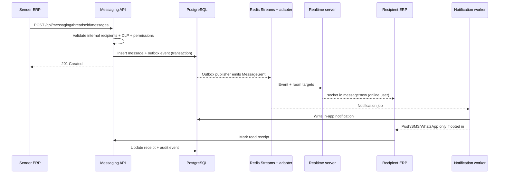
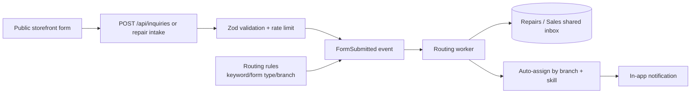
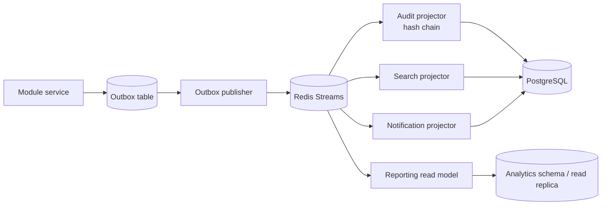
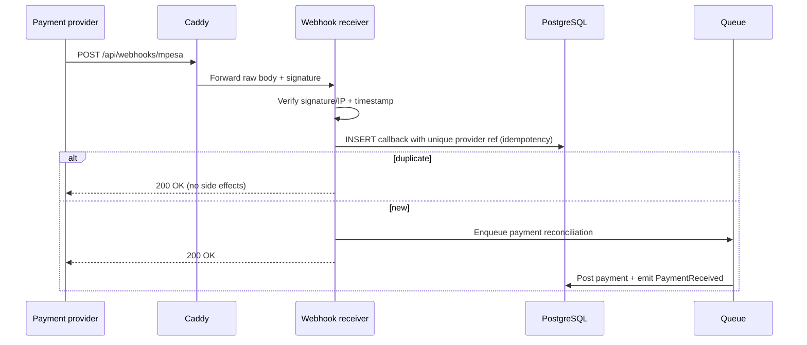
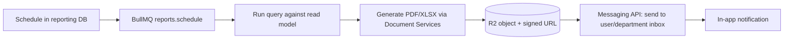
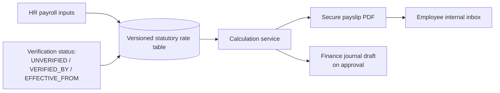

# Data Flows

Comet Healthcare Enterprise Platform — Phase 1  
Version 1.0 · 2026-11-22 · Status: Draft for review

All diagrams are Mermaid source in Markdown; no renderer dependency is added.

---

## 1. Standard API request with tenant context

```mermaid
sequenceDiagram
    participant C as ERP/web/cms client
    participant G as Caddy + API gateway
    participant A as Auth + policy
    participant S as Module service
    participant DB as PostgreSQL + PgBouncer
    participant E as Redis Streams/outbox

    C->>G: HTTPS + JWT/API key + X-Correlation-ID
    G->>A: Verify token, session, scopes
    A->>A: Load companyId, branchIds, roles, ABAC attrs
    A->>S: Authorised command/query
    S->>DB: BEGIN; SET LOCAL app.company_id / app.branch_id
    S->>DB: RLS-scoped read/write
    S->>E: Insert outbox event in same transaction
    DB-->>S: Commit
    E-->>Workers: Async publish after commit
    G-->>C: DTO + correlation ID
```

---

## 2. Internal message send → realtime delivery



Offline users receive the message on reconnect; the client queues the send locally and replays with an idempotency key. Read receipts are never sent for internal notes.

---

## 3. Website repair/form → department inbox routing



No external email is used for staff handoff. External confirmation to the customer goes through the separate external mail gateway.

---

## 4. File upload, scan, and signed download

```mermaid
sequenceDiagram
    participant U as User
    participant API as API
    participant R2 as Cloudflare R2
    participant Q as BullMQ scan queue
    participant AV as Virus-scan hook
    participant DB as PostgreSQL metadata

    U->>API: Request upload URL (name, MIME, size, tenant)
    API->>API: Check quota, MIME policy, purpose
    API-->>U: Signed PUT URL + object key
    U->>R2: PUT encrypted object
    U->>API: Confirm upload
    API->>DB: Insert file metadata (status: scanning)
    API->>Q: Enqueue scan + magic-number verify
    Q->>AV: Scan stream
    AV-->>Q: clean / infected
    Q->>DB: Update scan status; quarantine if infected
    U->>API: Request download URL
    API->>DB: Authorise + log access
    API-->>U: Short-lived signed GET URL
```

---

## 5. Domain event → audit, search, notification



Consumers are idempotent by `eventId`. Failed consumers retry with backoff and then move to a dead-letter stream with an alert to the Management/IT inbox.

---

## 6. M-Pesa / payment webhook



Card data never enters this flow; only opaque gateway references are stored.

---

## 7. Scheduled report delivery to internal inbox



Reports are never sent to external email by default. Delivery is logged with report ID, scope, and recipient.

---

## 8. Payroll/statutory calculation data flow (future phase)



> Statutory rates are configuration, not code constants. PAYE, NSSF, SHIF, Housing Levy, and VAT/eTIMS payload rules must be verified against current KRA and government publications and signed off before use.

---

## 9. Backup and data-subject flows

```mermaid
flowchart LR
    PG[PostgreSQL] --> B[Hourly WAL + daily full backup]
    B --> Enc[restic AES-256 encryption]
    Enc --> R2[(Off-site R2 repository)]
    R2 --> Drill[Quarterly restore drill]

    DS[Data subject request] --> API[/api/privacy/requests]
    API --> Audit[Logged request + verification]
    Audit --> Export[Scoped export or deletion job]
    Export --> Review[Compliance approval]
    Review --> DS
```

---

## 10. Data classification applied to flows

| Class | Examples | Flow rule |
|---|---|---|
| Public | Storefront content | No auth required; cached at edge |
| Internal | Messages, stock levels, org chart | Authenticated staff; tenant + branch scoped |
| Confidential | Invoices, salaries, customer details | Role + ABAC required; audit reads |
| Restricted | National ID, KRA PIN, bank accounts, medical notes, card data | Encrypted columns; never in events/logs; explicit permission + audit; card data not stored at all |
