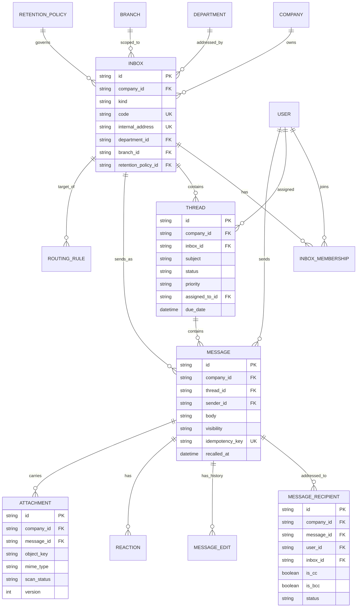
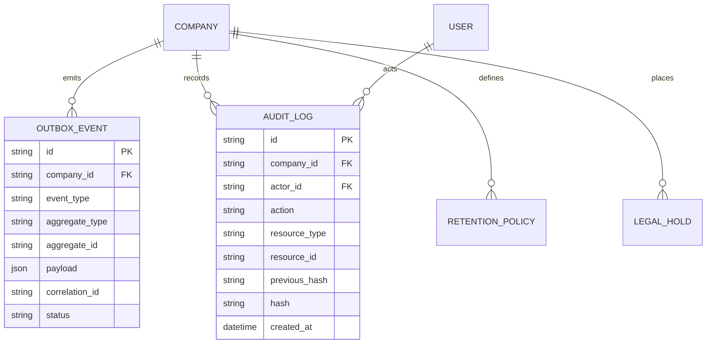

# Entity Relationship Diagram

Comet Healthcare Enterprise Platform — Phase 3  
Version 1.1 · 2026-11-22 · Status: Draft for review

The authoritative schema is `prisma/schema.prisma`. This diagram is a readable map of the Organisation, Identity, Messaging, and Platform domains. Phase 3 adds per-tenant email uniqueness, password history, lockout fields, and OIDC linkage. Later modules add their own contexts without changing these ownership rules.

---

## 1. Organisation and Identity

```mermaid
erDiagram
    COMPANY ||--o{ BRANCH : has
    COMPANY ||--o{ DEPARTMENT : has
    COMPANY ||--o{ JOB_TITLE : has
    COMPANY ||--o{ USER : employs
    COMPANY ||--o{ USER_GROUP : has
    COMPANY ||--o{ ACCESS_ROLE : has
    COMPANY ||--o{ PERMISSION : defines
    DEPARTMENT ||--o{ DEPARTMENT : parent_of
    USER ||--o{ USER : manages
    USER ||--o{ SESSION : has
    USER ||--o{ MFA_CREDENTIAL : has
    USER ||--o{ RECOVERY_CODE : has
    USER ||--o{ PASSWORD_HISTORY : retains
    USER ||--o{ API_KEY : owns
    ACCESS_ROLE ||--o{ ROLE_PERMISSION : grants
    PERMISSION ||--o{ ROLE_PERMISSION : used_by
    USER ||--o{ USER_ROLE : assigned
    ACCESS_ROLE ||--o{ USER_ROLE : assigned_to
    USER_GROUP ||--o{ GROUP_MEMBER : contains
    USER ||--o{ GROUP_MEMBER : member_of

    COMPANY {
      string id PK
      string code UK
      string name
      string country
      string locale
      string currency
    }
    BRANCH {
      string id PK
      string company_id FK
      string code UK
      string name
      string type
      string city
    }
    DEPARTMENT {
      string id PK
      string company_id FK
      string code UK
      string name
      string internal_address UK
      string parent_id FK
    }
    USER {
      string id PK
      string company_id FK
      string email UK_per_tenant
      string password_hash
      string identity_provider
      string external_id
      string role
      string status
      int failed_login_attempts
      datetime lockout_until
      datetime password_changed_at
      boolean mfa_enabled
      string branch_id FK
      string department_id FK
      string manager_id FK
      string company
    }
    PASSWORD_HISTORY {
      string id PK
      string company_id FK
      string user_id FK
      string hash
      datetime created_at
    }
```

---

## 2. Messaging



---

## 3. Platform services



---

## 4. Governance rules encoded in the schema

- Every business table has `company_id`; addressable tables also have `branch_id`.
- `Message.visibility` separates recipient-visible messages from `INTERNAL` notes.
- `Message.idempotencyKey` makes offline retry/replay safe.
- `MessageEdit` preserves edit history; `recalledAt` preserves recall state.
- `Attachment.scanStatus` gates previews and downloads.
- `AuditLog.previousHash` + `hash` support tamper detection. Database rules prevent update/delete.
- `LegalHold` and `RetentionPolicy` drive the Phase 5 retention worker.
- `OutboxEvent` carries domain events with correlation IDs for audit and projections.

---

## 5. Partitioning plan

`Message`, `MessageRecipient`, `AuditLog`, and `OutboxEvent` are the planned high-volume tables. Phase 2 creates the indexes and tenant/branch policies. Range partitioning by `createdAt` will be added in a dedicated migration before production load, using the raw-SQL path defined in ADR-0002. No partition is created in this phase to avoid an unnecessary table rewrite while the schema is still changing.

---

## 6. Migration inventory

| Migration | Purpose |
|---|---|
| `20261122000000_init` | Full Phase 2 schema, app role, grants, audit immutability rules |
| `20261122000100_fix_rls_column_names` | Corrective RLS policies using Prisma's camelCase `companyId`/`branchId` columns |
| `20261122000200_identity_auth` | Per-tenant email uniqueness, OIDC/lockout columns, password history table and RLS |
| `20261122000300_add_identity_roles` | Adds `STAFF`, `MANAGER`, `COMPLIANCE` values to the `Role` enum |

The initial migration's RLS loop matched snake_case columns, so it created no tenant policies. The corrective migration detects `"companyId"`/`"branchId"` and applies the intended tenant/branch scope. RLS verification confirmed: default tenant (`cmp_comet`) sees 2 users, 1 thread, 10 inboxes; switching to `cmp_other` sees 0 of each.

Rollback: restore the pre-migration Postgres volume snapshot. A forward "down" migration is not provided for the initial schema.
